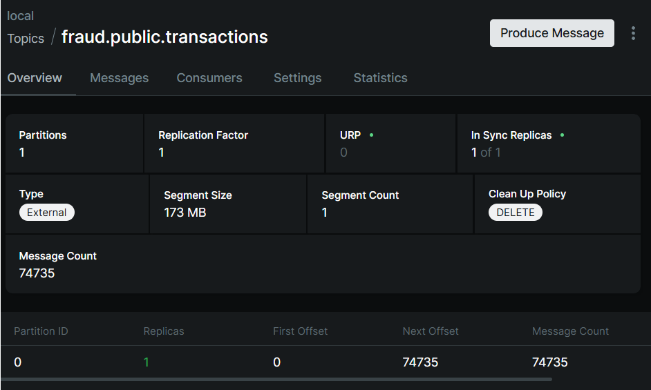
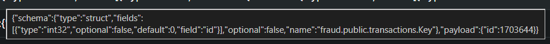

### Part 1 — The decision (in the session)

**Your task (for the write-up):** one paragraph, 5–8 sentences. Which
option do you choose for this scenario, and why? What does it cost, and how
would you notice in production before it hurts? Which option would you
choose if your team *owned* the payment path?

### My Solution to part 1:
Analyzing the options

- Polling: Simple to set up and no change required to the payment application code, however, there is the problem of
missing rows and high database overhead.

- Dual Write: Incurs no extra DB storage or WAL overhead and had low latency when healthy,
but a crash between commit and send loses the event permanently

- Outbox: Satisfies requirements R2, R3 and R4 with minor write overhead (one extra row per transaction)
But it cannot be used when payment path is owned by another team

- Log-based CDC: Satisfies all requirements R1, R2, R3, and R4 with a risk of disk exhaustion if the connector stops for long enough. 

| Option | R1 | R2 | R3 | R4 |
|---|---|---|---|---|
| 1. **Polling** | Not Satisfied | Not Satisfied | Not Satisfied | Not Satisfied | 
| 2. **Dual write** | Not Satisfied | Not Satisfied | Not Satisfied | Satisfied |
| 1. **Outbox** | Not Satisfied | Satisfied | Satisfied | Satisfied |
| 1. **Log-based CDC** | Satisfied | Satisfied | Satisfied | Satisfied |

**Decision** 
- **For this scenario**, I would choose the Log-based CDC as it is the only option that guarantees 100% completeness 
and strict commit ordering (R2) without modifying the application or adding query load to PostgreSQL. 
  - What It Costs to Maintain:
  - The operational cost is managing the PostgreSQL replication slot. If the connector (Debezium) stops, the disk may fill up
  crashing the database.
  - In production, this can be caught by closely monitoring the connection status, as well as setting up alerts on 
  replication slot-lag

- **In the scenario that my team owned the payment path** I would choose the transactional Outbox as a system with the lower
complexity. It also achieves consistency and completeness but avoids the replication slot and disk fill-up risks of the CDC.

### Part 2 — The pipeline in three runs (in the session)

#### Run 1 — Debezium's defaults
**Predict:** do all three velocity instances share the work, and does R4
pass? Write down your guess and your reason, then run the routine (steps
2–5; there is nothing to stop yet). Also look in the Kafka UI: how many partitions does the topic have, and what is
the key of an event?

**My Prediction:**

We have three velocity instances which should be enough to process a throughput of 1000 payments/s.
Thus, we should have good latency, and no missed alerts, passing R4.

**Run 1 Output**
  ```bash
Consumer groups on the CDC topic(s)   [R2]
  group                    topic                              partitions  members       lag
  velocity-agent           fraud.public.transactions                   1        3    78,518

Agent instances (telemetry of this run)   [R3, R4]
  instance         pid model      transactions  cardholders  out-of-order  lag (s)      seen
  vel-1           2682 velocity         54,963       42,283             0     75.5       4s ago

Alerts on 'fraud-alerts' (committed, this run)

  velocity model (card testing)
    R3  frauds caught          4/8  (50%)   FAIL  (>= 90 %)
    R3  false alerts           0   PASS  (at most 10 % of the flagged transactions)
    R4  alert latency p50/p95  53.3 s / 77.6 s   FAIL  (p95 <= 5 s after the commit)
        duplicate alerts       0   (info: alerts case management got twice)

   ```
  Observation:
  - On the velocity model, it fails R3 at frauds caught and fails R4 latency requirements
  - The anomaly model also fails R4 latency requirements (passed on a second run)
  - We have three velocity instances but only 1 partition.
  - 
  - In the Kafka UI, we indeed have only one partition taken by one velocity agent.
  - Event key: "id"


  Why:
  - Debizium by defaut, created `fraud.public.transactions` with 1 partition.
  - With only one partition available, `vel-1` claimed the partition, leaving `vel-2` and `vel-3` completely idle (they don't appear under  Agent Instances)
  - The velocity model costs ~2ms per payment so one instance can handle 400-500 payments. card_processor.py committed 1001 transactions/s (165,309 in 165 seconds). `vel-1` could only process 54,963 of those (333.11 transactions per second), building a backlog of 78,518 messages (75.5 seconds behind real time)
  - The anomaly model costs ~0.3ms per payment (3000 payments/s capacity) so one instance could handle the full stream with only a 0.8s lag.

#### Run 2 — more partitions

**Predict:** now all three instances work. Will the velocity model catch
≥ 90 % of the card-testing frauds (R3)? Think of the key you saw in Run 1.
Then save the file and repeat the **whole routine, from step 1**: stop the
agents and the card processor, run `connector.py` again, restart both, wait,
scoreboard. You know it worked when the agents print `[vel-1] assigned
partitions [0, 1]`, `[vel-2] … [2, 3]`, `[vel-3] … [4, 5]`.

**My Prediction:**

Now we have 6  partitions which is enough for all three velocity instance to have partitions and be active. We should now get low latency and no missed alerts

**Run 2 Output**


```bash
Run 1795000753: started 12:19:13, 144,694 transactions in 145 s (997/s), 15 frauds so far (still running)
Consumer groups on the CDC topic(s)   [R2]
  group                    topic                              partitions  members       lag
  velocity-agent           fraud.public.transactions                   6        3     3,605

Agent instances (telemetry of this run)   [R3, R4]
  instance         pid model      transactions  cardholders  out-of-order  lag (s)      seen
  vel-1           6094 velocity         45,115       36,315             1      1.3       1s ago
  vel-2           6095 velocity         44,774       36,142             0      1.3       1s ago
  vel-3           6096 velocity         45,008       36,185             0      1.3       1s ago

Alerts on 'fraud-alerts' (committed, this run)
  velocity model (card testing)
    R3  frauds caught          1/7  (14%)   FAIL  (>= 90 %)
    R3  false alerts           0   PASS  (at most 10 % of the flagged transactions)
    R4  alert latency p50/p95  0.8 s / 0.8 s   PASS  (p95 <= 5 s after the commit)
        duplicate alerts       0   (info: alerts case management got twice)
```

Observation:

- As predicted, the increase in the number of partitions from 1 to 6 solved the bottleneck, 
- We now get a pass on the latency requirement (R4). 
- All three velocity instances are active and the workload is balanced between them. The lag thus drops to between 0.7 and 1.2 seconds.
- However, it still fails in the frauds caught section. 

Why?

- Debezium by default keys every Kafka message by the table's primary key ("id") because the message key has not yet been configured.
- Because each payment gets a new auto-incremented primary key id, when a thief sends 12 rapid card-testing payments, they are scattered across all 6 partitions.
- The model counts each cardholder's payments in the last 60 s and flags the 8th, but if the payments are scattered across partitions, that threshold may never be reached.

#### Run 3 — the cardholder as the key

**Predict:** what will the key of an event look like in the Kafka UI, and
what changes on the scoreboard? Then save the file and repeat the **whole
routine, from step 1**, as in Run 2.

**My Prediction:**

We have fixed the key mismatch by updating the message key in fraud-connector.json, so now we should get a pass on all requirements R2, R3 and R4.

**Run 2 Output**

```markdown
Consumer groups on the CDC topic(s)   [R2]
  group                    topic                              partitions  members       lag
  velocity-agent           fraud.public.transactions                   6        3     5,398

Agent instances (telemetry of this run)   [R3, R4]
  instance         pid model      transactions  cardholders  out-of-order  lag (s)      seen
  vel-1           9068 velocity         46,627       25,184             0      1.3       3s ago
  vel-2           9069 velocity         46,526       25,033             0      1.3       2s ago
  vel-3           9070 velocity         46,709       25,110             0      1.3       3s ago

Alerts on 'fraud-alerts' (committed, this run)
  velocity model (card testing)
    R3  frauds caught          7/7  (100%)   PASS  (>= 90 %)
    R3  false alerts           1   PASS  (at most 10 % of the flagged transactions)
    R4  alert latency p50/p95  0.8 s / 1.4 s   PASS  (p95 <= 5 s after the commit)
        duplicate alerts       0   (info: alerts case management got twice)
```

Findings:

As predicted, we get a pass on every requirement R on the scoreboard. For the velocity model, All frauds were caught, Only one false alert and alert latency is within range.
The anomaly model also gets all passes.

### Part 3. One closing answer: 

*Debezium chose two defaults that you had to change.
What would have happened in production if nobody had checked them, and
how could the team have noticed?* 

**My Answer:**

If the two defaults (1 partition and primary key partitioning) were not changed and the system went into production unchecked, 
it would have silently degraded, either failing under high consumer lags, or silently missing frauds without throwing any errors
or system crashes. 

The team could catch this in production by 
- monitoring the consumer group lag per partition,
- tracking the assignment of partitions across instances, and
- by running evaluation metrics.